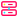
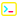
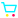
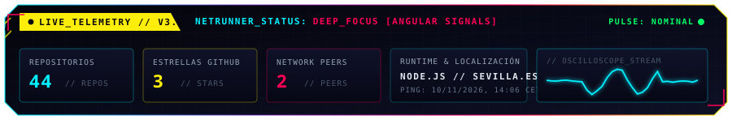
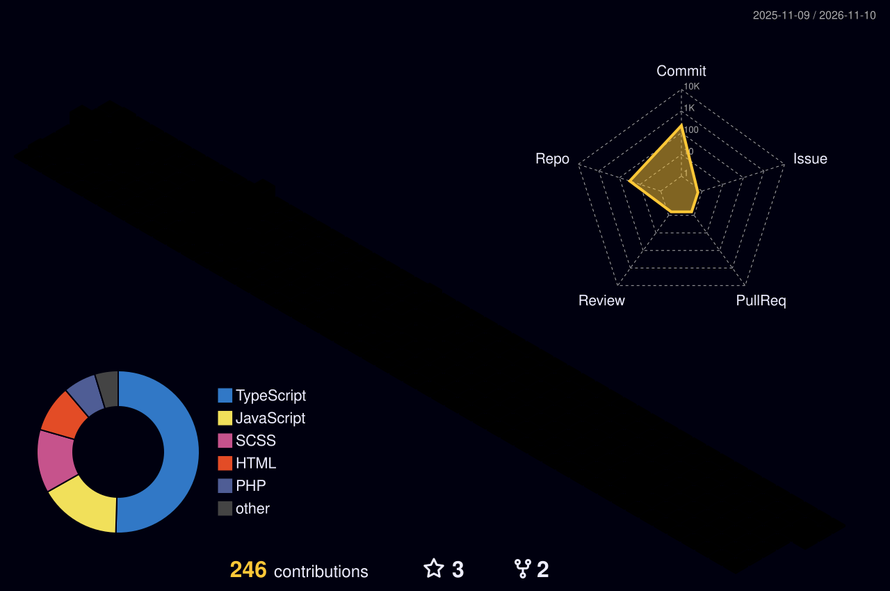

<!-- =================================================================== -->
<!-- HERO BANNER LOCAL // CYBERPUNK NIGHT CITY EDITION -->
<!-- =================================================================== -->

  

    

  <!-- SUBTÍTULO ANIMADO CON EFECTO TYPING (FIRA CODE // HUD SYNTAX) -->
  

   

  <!-- BADGES DE CONTACTO Y TELEMETRÍA (NIGHT CITY COLOR PALETTE) -->
  

    
    
    
    
    
  

  

<!-- =================================================================== -->
<!-- SECTION 01: SYS_BIO // SOBRE MÍ & ENFOQUE TÉCNICO -->
<!-- =================================================================== -->

<table align="center" width="100%" border="0" cellpadding="8" cellspacing="0">
  <tr>
    <td width="58%" valign="top">
      

        ¡Hola! Soy <b>Juan Carlos Dorado López</b>, desarrollador de software y estudiante de <b>1º Grado en Ingeniería Informática</b> radicado en Utrera (Sevilla).
      

      

        Me enfoco en el desarrollo web moderno bajo <b>Clean Architecture</b>, <b>patrones reactivos</b> y experiencias fluidas de usuario. Especializado en el ecosistema <b>Angular + TypeScript</b> (Signals, Control Flow, RxJS) y en su integración con servicios backend y cloud en tiempo real.
      

      

         <b>Base Operativa:</b> Utrera, Sevilla, España 
         <b>Foco Actual:</b> Angular Signals, Microfrontends, TypeScript estricto y Firebase. 
         <b>Misión:</b> Construir soluciones escalables, testeables y de alto impacto.
      

    </td>
    <td width="42%" valign="middle" align="center">
      
        
      
        
      
    </td>
  </tr>
</table>

  

<!-- =================================================================== -->
<!-- SECTION 02: CYBER_ARSENAL // STACK TECNOLÓGICO -->
<!-- =================================================================== -->

  <table border="0" width="100%" cellpadding="10" cellspacing="0">
    <tr>
      <td width="33%" align="center" valign="top">
        <h4> [ FRONTEND_CORE ]</h4>
        
          
        <b>Angular • TypeScript • JavaScript • RxJS HTML5 • CSS3 • Tailwind • Sass</b>
      </td>
      <td width="33%" align="center" valign="top">
        <h4> [ BACKEND_RUNTIME ]</h4>
        
          
        <b>Node.js • Express • PHP Firebase • MySQL • MongoDB</b>
      </td>
      <td width="33%" align="center" valign="top">
        <h4> [ DEVOPS_TOOLING ]</h4>
        
          
        <b>Git • GitHub • GitHub Actions VS Code • Postman • Docker • Linux</b>
      </td>
    </tr>
  </table>

  

<!-- =================================================================== -->
<!-- SECTION 03: OPERATIONS // PROYECTOS DESTACADOS -->
<!-- =================================================================== -->

<table width="100%" border="0" cellpadding="10" cellspacing="0">
  <tr>
    <td width="50%" valign="top">
      <h4> Tienda Online // API REST &amp; Web Client</h4>
      

        
        
      

      

        Aplicación web completa con catálogo interactivo inspirada en el flujo de comercio electrónico moderno. Consume una <b>API RESTful personalizada</b>, gestiona carrito persistente en <code>LocalStorage</code> y almacena datos en PHP/MySQL.
      

      

        
      

    </td>
    <td width="50%" valign="top">
      <h4> Portfolio Personal // Showcase Cloud</h4>
      

        
        
      

      

        Showcase profesional personal desplegado en la infraestructura global de <b>Firebase Cloud</b>. Diseño interactivo enfocado en accesibilidad, microinteracciones y alto rendimiento visual.
      

      

        
      

    </td>
  </tr>
</table>

  

<!-- =================================================================== -->
<!-- SECTION 04: TELEMETRY // ESTADÍSTICAS Y RENDIMIENTO -->
<!-- =================================================================== -->

  

  <!-- TARJETAS DE STATS Y TOP LANGUAGES EN ALTA VELOCIDAD -->
  <table border="0" cellpadding="0" cellspacing="0">
    <tr>
      <td align="center">
        
      </td>
      <td align="center">
        
      </td>
    </tr>
  </table>

   

  <!-- RACHA DE ACTIVIDAD CONTINUA (CYBERPUNK NIGHT CITY THEME) -->
  

  

<!-- =================================================================== -->
<!-- SECTION 05: NEURAL_GRID // ACTIVIDAD ISOMÉTRICA 3D -->
<!-- =================================================================== -->

  <picture>
    <source media="(prefers-color-scheme: dark)" srcset="./profile-3d-contrib/profile-night-rainbow.svg">
    <source media="(prefers-color-scheme: light)" srcset="./profile-3d-contrib/profile-season-animate.svg">
    
  </picture>

<!-- =================================================================== -->
<!-- SECTION 06: RUNNER // AUTÓMATA SNAKE DE COMMITS -->
<!-- =================================================================== -->

  <picture>
    <source media="(prefers-color-scheme: dark)" srcset="https://raw.githubusercontent.com/jucagolddev/jucagolddev/output/github-contribution-grid-snake-dark.svg">
    <source media="(prefers-color-scheme: light)" srcset="https://raw.githubusercontent.com/jucagolddev/jucagolddev/output/github-contribution-grid-snake.svg">
    
  </picture>

  

<!-- =================================================================== -->
<!-- FOOTER // COMMS CHANNEL -->
<!-- =================================================================== -->

  

    <b>// INITIATE COMMS // ¿Te interesa colaborar en algún proyecto o conectar profesionalmente?</b> 
    
  

// JUAN CARLOS DORADO LÓPEZ &bull; ARCHITECTURE &amp; CLEAN CODE &bull; AUTOMATED VIA GITHUB ACTIONS //

