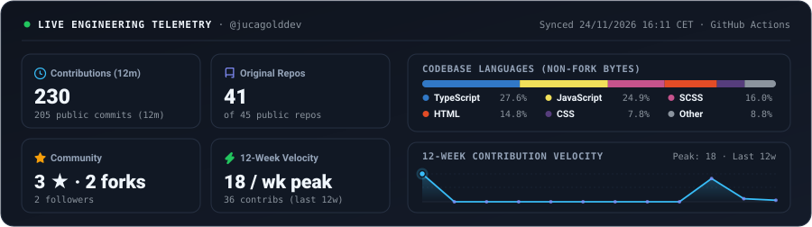
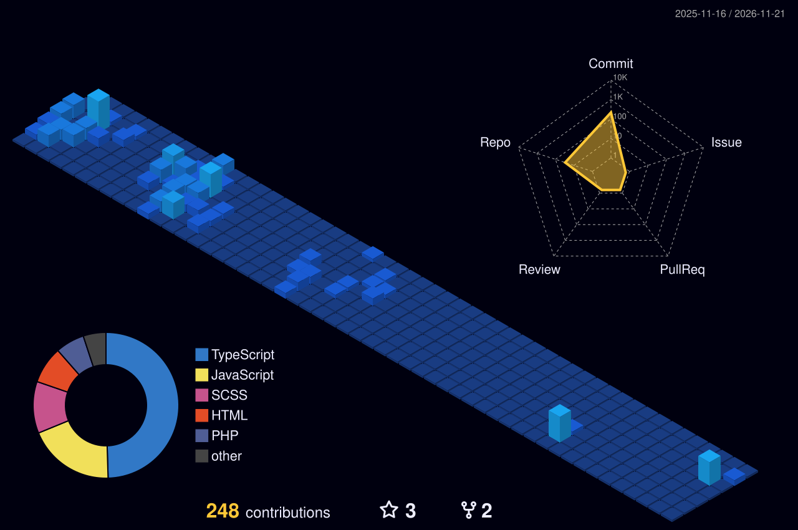

  <picture>
    <source media="(prefers-color-scheme: dark)" srcset="./assets/hero-dark.svg" />
    <source media="(prefers-color-scheme: light)" srcset="./assets/hero-light.svg" />
    
  </picture>

    

  

    
    
    
    
  

---

### Posicionamiento y Principios de Ingeniería

Desarrollador de Aplicaciones Web (**DAW**) y estudiante de Grado en Ingeniería Informática (**UBU**), especializado en arquitectura Frontend con **Angular & TypeScript**, sistemas Full-Stack y experiencias interactivas de alto rendimiento a 60 FPS. Combino el rigor estructural de **Clean Architecture / DDD** con una sólida base artística orientada al detalle en UI/UX.

| Arquitectura & Estado | UI & Rendimiento | Full-Stack & Entrega |
| :--- | :--- | :--- |
| Separación estricta de capas (Dominio, Aplicación, Presentación), TypeScript estricto (`0% any`) y estado reactivo con **Angular Signals** y **RxJS**. | Sistemas de diseño escalables, renderizado GPU con **Three.js / WebGL** y Canvas 2D, accesibilidad **WCAG 2.1 AA** y budgets estrictos de bundle. | APIs RESTful con **Node.js / Express**, Java y PHP, bases de datos relacionales/NoSQL, Firebase y pipelines automatizados con **GitHub Actions**. |

---

### Proyectos Destacados

<table>
  <tr>
    <td width="50%" valign="top">
      <h4><a href="https://porfolio-juancarlosdoradolopez.web.app/">Portfolio Interactivo 3D</a></h4>
      
<code>Angular SSR</code> <code>Three.js</code> <code>TypeScript</code> <code>Firebase</code>

      
Ecosistema web personal con mapa neural 3D interactivo en WebGL a 60 FPS, arquitectura limpia desacoplada, terminal CLI integrada, 105 tests y cumplimiento WCAG 2.1 AA (Lighthouse 99).

    </td>
    <td width="50%" valign="top">
      <h4><a href="https://github.com/jucagolddev/CalculadoraVectores">VectorLab ℝ² (CalculadoraVectores)</a></h4>
      
<code>JavaScript ES+</code> <code>Canvas 2D</code> <code>KaTeX</code> <code>DDD + IoC</code>

      
Calculadora y simulador gráfico interactivo de vectores en ℝ² estructurado con Clean Architecture / DDD e inversión de dependencias, modo ejercicios y resolución matemática paso a paso.

    </td>
  </tr>
  <tr>
    <td width="50%" valign="top">
      <h4><a href="https://github.com/jucagolddev/vacapp">Vacapp</a></h4>
      
<code>TypeScript</code> <code>Angular</code> <code>PWA Offline-First</code> <code>PL/pgSQL</code>

      
Aplicación web progresiva de gestión ganadera con alta densidad de información, diseño de alto contraste para uso bajo luz solar y persistencia offline-first para entornos sin cobertura.

    </td>
    <td width="50%" valign="top">
      <h4><a href="https://github.com/jucagolddev/CampusHub">CampusHub</a></h4>
      
<code>TypeScript</code> <code>Angular</code> <code>SCSS</code> <code>Full-Stack</code>

      
Plataforma Full-Stack con cliente y servidor desacoplados para centralizar, gestionar y proyectar proyectos académicos con interfaz moderna basada en sistemas modulares.

    </td>
  </tr>
</table>

Ver más proyectos públicos y laboratorios

| Proyecto | Stack | Descripción |
| :--- | :--- | :--- |
| **[Sonora](https://github.com/jucagolddev/Sonora)** | `Angular` `Node.js` `Express` `MySQL` | Plataforma web accesible (WCAG 2.1) para gestión, reproducción y compartición de recursos sonoros de alta fidelidad. |
| **[JUCASHOP](https://github.com/jucagolddev/TiendaOnlineConApiRestYClienteHtml)** | `JavaScript` `PHP REST` `MySQL` `SCSS` | E-commerce Full-Stack construido desde cero sin frameworks, con consumo de API RESTful propia y carrito persistente en `LocalStorage`. |
| **[Node ORM REST API](https://github.com/jucagolddev/Api_Rest_Node_ORM_Sequelize_DoradoLopezJuanCarlos)** | `Node.js` `Express` `Sequelize` | Servicio API RESTful con modelado relacional, validaciones y operaciones CRUD sobre ORM Sequelize. |
| **[Gestión de Asignaturas REST](https://github.com/jucagolddev/GestionAsignaturasRest)** | `Java` `REST` | Servicio backend REST en Java para administración académica estructurada. |
| **[MejorApp Releases](https://github.com/jucagolddev/mejorapp-releases)** | `Android` `Releases` | Canal público de distribución oficial de binarios e instaladores APK de MejorApp. |

---

### Stack Técnico por Capas

| Capa | Tecnologías |
| :--- | :--- |
| **Frontend & Gráficos** | <picture><source media="(prefers-color-scheme: dark)" srcset="https://skillicons.dev/icons?i=angular,ts,js,rxjs,threejs,tailwind,sass,html,css&theme=dark" /><source media="(prefers-color-scheme: light)" srcset="https://skillicons.dev/icons?i=angular,ts,js,rxjs,threejs,tailwind,sass,html,css&theme=light" /></picture> |
| **Backend & Datos** | <picture><source media="(prefers-color-scheme: dark)" srcset="https://skillicons.dev/icons?i=nodejs,express,java,php,cs,firebase,postgres,mysql,mongodb&theme=dark" /><source media="(prefers-color-scheme: light)" srcset="https://skillicons.dev/icons?i=nodejs,express,java,php,cs,firebase,postgres,mysql,mongodb&theme=light" /></picture> |
| **DevOps, Testing & Diseño** | <picture><source media="(prefers-color-scheme: dark)" srcset="https://skillicons.dev/icons?i=git,github,githubactions,docker,linux,vitest,figma,vscode&theme=dark" /><source media="(prefers-color-scheme: light)" srcset="https://skillicons.dev/icons?i=git,github,githubactions,docker,linux,vitest,figma,vscode&theme=light" /></picture> |

---

### Telemetría de Ingeniería en Vivo

  <picture>
    <source media="(prefers-color-scheme: dark)" srcset="./assets/telemetry-dark.svg" />
    <source media="(prefers-color-scheme: light)" srcset="./assets/telemetry-light.svg" />
    
  </picture>

---

### Actividad de Contribuciones

  <picture>
    <source media="(prefers-color-scheme: dark)" srcset="./profile-3d-contrib/profile-night-view.svg" />
    <source media="(prefers-color-scheme: light)" srcset="./profile-3d-contrib/profile-season-animate.svg" />
    
  </picture>

   

  <picture>
    <source media="(prefers-color-scheme: dark)" srcset="https://raw.githubusercontent.com/jucagolddev/jucagolddev/output/github-contribution-grid-snake-dark.svg" />
    <source media="(prefers-color-scheme: light)" srcset="https://raw.githubusercontent.com/jucagolddev/jucagolddev/output/github-contribution-grid-snake.svg" />
    
  </picture>

---

  Juan Carlos Dorado López · <a href="mailto:jucagolddev@gmail.com">jucagolddev@gmail.com</a> · <a href="https://porfolio-juancarlosdoradolopez.web.app/">Portfolio 3D</a> · Métricas y gráficos actualizados automáticamente cada día vía GitHub Actions.

